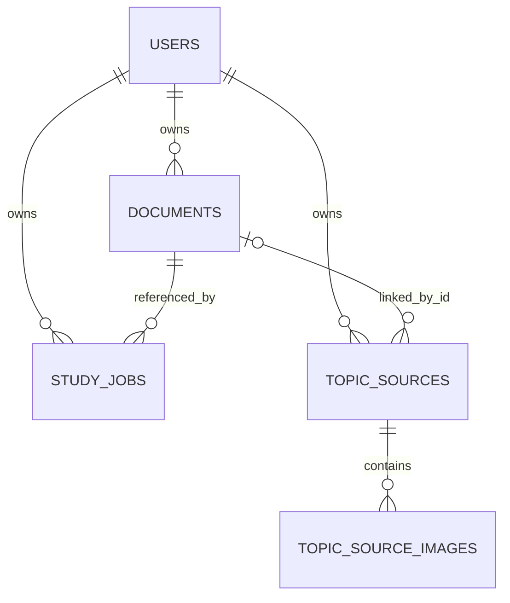

# Database and storage map

## SQLite architecture

`backend/app/services/db.py` uses a single stdlib `sqlite3` connection with `check_same_thread=False`, row objects, WAL journaling, `synchronous=NORMAL`, foreign keys enabled and an `RLock`. `transaction()` holds the lock for multi-statement work and can request `BEGIN IMMEDIATE` for read-then-write invariants. `PRAGMA user_version` migrations progress through version 5. There is no ORM or model class layer; services serialize several record fields as JSON columns.

The database path is `DATABASE_PATH` (default `.tmp/study.db`). `render.yaml` explicitly changes it to `/tmp/study.db`, so file durability depends on deployment storage configuration.

## Tables and relationships

### `documents`

Created in schema v1; v2 adds nullable `owner_id` plus owner index. Fields: `document_id` primary key, filename/format/size/path, created/expiry epoch, page count, extraction status, text-extractable flag, section count, total characters, `sections_json`, and `warnings_json`. Parsed section JSON contains index, anchor, raw text and normalized text. The original source bytes live in the filesystem path; the row is source metadata plus extracted content. Legacy migrated rows have `owner_id = NULL` and cannot pass exact owner checks.

### `study_jobs`

Created in v1; v2 adds nullable `owner_id` plus owner/created index. Primary key `job_id`; stores source `document_id` as a value, filename/format/mode/status, ISO timestamps and creation/expiry epochs, page/item counts, JSON items, document summary, warnings, optional error and progress JSON. No declared FK to `documents`: this permits a completed result to remain readable after its source record/file is deleted. Job payload includes owner internally; API `_public()` strips it before returning.

### `users`

Created in v2. `user_id` primary key; `token_hash` unique; `created_at`. Only SHA-256 digest of random bearer token is stored. There is no email/profile/password/device table, token revocation column or relational user FK.

### `topic_sources`

Created in v3; v4 adds `version`; v5 adds `jottings_text`. Fields include `source_id` primary key, non-null owner, optional linked document ID and metadata snapshot, status, image count, character count, topic/warning JSON, timestamps/expiry, optimistic concurrency version and typed jottings. Indexes support owner/created ordering and expiry. The linked document ID is not declared as a foreign key, allowing topic source metadata to remain if a document is deleted or expires.

### `topic_source_images`

Created in v3; v4 adds `transcript_source` default `ocr`. Composite primary key `(source_id, image_index)`; filename/content type/size/width/height, filesystem path, OCR status/text, warning JSON, creation time and transcript provenance. FK to `topic_sources(source_id) ON DELETE CASCADE`; foreign keys are enabled on database connection. Original image bytes are external files, not BLOBs.

## Relationships

The diagram's ownership links are logical filtering relationships; schema uses `owner_id` columns rather than user foreign keys. Document/job relationship is also logical (no FK). Topic image FK is actual and cascades at SQLite level.

## Filesystem layout and ownership

- Document originals are stored under `TEMP_DIR`, configured at startup by `DocumentStore`. The database records their paths. The exact file name/path generation is in `services/storage.py` (`new_document_id`, save/delete/reconcile routines); clients never receive raw server paths.
- Topic images are stored under `TEMP_DIR/topic_sources/{source_id}/{index}.{png|jpg}`. Topic image rows store path, but response schemas omit it. `TopicSourceStore.delete()` removes directory and rows.
- Export bytes are generated in memory from persisted job JSON and streamed in the response. Mobile `expo-file-system` writes the downloaded result to app cache; Expo Sharing hands it to the OS. No device-side study database is present in the inspected files.
- Backend logs record operational metadata and request IDs; parser/API logging is designed to avoid document content and token query logging. Docker disables Uvicorn access logging because a download token may otherwise appear in URL queries.

## Data lifecycle

1. **Upload:** document bytes are read, parsed, then stored as a file and metadata/sections row. TTL uses `RETENTION_MINUTES`, default 10,080 (seven days).
2. **Study request:** each job write persists the full result payload into `study_jobs`; job TTL starts at write/update. Existing results remain after source deletion.
3. **Topic source creation:** images are written and topic/image rows inserted. Per-user active topic source count is enforced transactionally when DB is configured. OCR transcript and jottings are stored as ordinary text in SQLite.
4. **Edit:** topic/transcript/jottings patch updates rows; version compare-and-swap retries stale writes. Changing source text clears saved topic list as stale. Original image bytes remain unchanged.
5. **Delete document:** removes its source file and record. It does not cascade to study jobs or topic sources. Those later responses report unavailable source; study jobs remain readable/exportable, while new processing/matching cannot use the missing source.
6. **Delete topic source:** deletes topic source and child image rows and removes image directory; linked document remains.
7. **Expiry:** startup and periodic cleanup sweep documents/files, jobs and topic source records/files. Access paths also check expiry. User identities are not TTL-cleaned in the code inspected.
8. **Restart:** SQLite-backed records hydrate on startup and document storage reconciles file presence. In-flight asyncio job tasks are not durable; persisted queued/running status can outlive the task. On Render free, `/tmp` database and files reset on restart/redeploy regardless of retention code.

## Ownership invariants

`main.py` resolves a bearer token to user ID and places it on `request.state.user_id`. Routes pass this owner into store lookups. Document, job and topic-source read/update/delete paths check exact owner match. Non-owned document/topic/job IDs are generally reported as not-found to avoid enumeration. Legacy ownerless documents/jobs remain on disk until expiry but are invisible to owner-scoped requests. Topic sources require owner at creation and owner matching on every retrieval.

Tests in `backend/tests/test_isolation.py`, `test_access_control.py`, `test_persistence.py`, `test_topic_sources.py` and `test_topic_analysis.py` exercise ownership, migrations, reload and TTL behavior. Test presence/pass results do not test persistence on Render's actual filesystem.

## Persistence limitations and notable design facts

- Topic source inputs persist, but generated topic output does not have a table or stored job representation.
- Database JSON retains document section text and study output, so source text can remain after source file deletion until job/document retention removes it.
- User rows and all data are on the same SQLite database; there is no cross-device account association.
- SQLite is single-file/single-process oriented in deployment config. Docker explicitly enforces one worker; horizontal scaling would require shared durable data and coordination beyond this implementation.
- `docs/data-model.md` describes server and client state, but any statement that SQLite survives restart depends on a persistent mount. Current `render.yaml` uses ephemeral `/tmp`.
