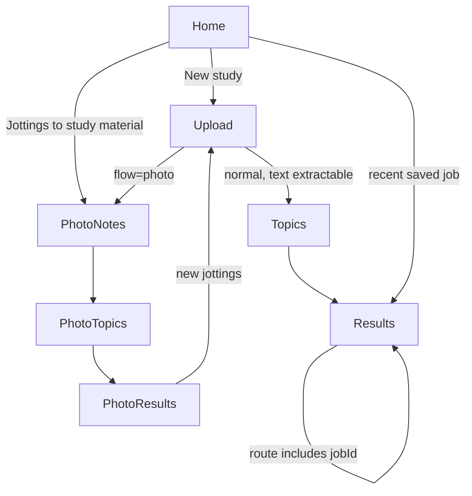

# Frontend UX and navigation map

## App shell and routes

`mobile/app/_layout.tsx:4` renders an Expo Router `Stack`. File-based route names are `/` (`index.tsx`), `/upload`, `/topics`, `/results`, `/photo-notes`, `/photo-topics`, and `/photo-results`. Header titles are set for the workflow screens. There is no tab navigator, drawer, or authentication screen. Root stack registration makes the screens routable, but the two flows are separate: Home's “New study” enters `/upload`; Home's “Jottings to study material” enters `/photo-notes` directly. `Upload` supports `flow=photo` and routes to `/photo-notes` with a `documentId`.

`mobile/components/screen.tsx` supplies the shared safe-area/scroll wrapper. `primary-button.tsx` exports the reusable `Card` and `PrimaryButton`; no business logic is in these components.

## Screen reference

### Home — `mobile/app/index.tsx`

- **Purpose/content:** backend status card, refresh affordance, “Jottings to study material”, “New study”, and recent study-job list.
- **State:** `status` (`loading | ok | error`) and `recent` (`loading | ok | error`). `fetchStatus()` wraps `getHealth()` and converts `ApiError`; `loadRecent()` calls `listStudyJobs()`.
- **Lifecycle:** one mount effect loads health; `useFocusEffect` reloads history when Home regains focus. Refresh re-requests both. A health request is not the identity bootstrap; history request is authenticated and causes `ensureUserToken()` if necessary.
- **Actions/routes:** new study -> `/upload`; jottings -> `/photo-notes`; recent item -> `/results?jobId=...`.
- **States:** status loading, healthy/degraded health payload, API error; history loading, empty message, loaded cards, or error. Existing topic sources/results do not appear in this history list.

### Upload — `mobile/app/upload.tsx`

- **Purpose/content:** selects a PDF or DOCX, uploads immediately, then shows file name, format, size, pages/sections, character count, extraction status and warnings.
- **State:** discriminated `phase` (`idle`, `picking`, `uploading`, `done`, `error`), `maxUploadMb`, elapsed upload seconds. An effect fetches the health limit. The `flow` route parameter selects normal vs photo labels/routing.
- **Actions:** “Choose file” calls Expo DocumentPicker and `uploadAsset`; while uploading shows a spinner and elapsed time. If selection is canceled, phase returns to idle. If metadata size exceeds the fetched limit, upload is rejected client-side. Upload errors retain the selected file for “Retry upload”. On successful, extractable document, “Continue to topics” routes to `/topics?documentId=...`; photo mode routes to `/photo-notes?documentId=...`.
- **Validation/error:** client file-size check is advisory; server enforces actual bytes, file signature and format. Unsupported/corrupt/empty/no-text response is shown through the result card/warnings. Continue is only rendered for extractable text.
- **API:** `getHealth()` and `uploadDocument()`.

### Topics & Mode — `mobile/app/topics.tsx`

- **Purpose/content:** selects one of the legacy document-study modes: extracted text only, text plus AI summaries, or AI summaries only. It explains each option and checks basic server AI configuration from health state where shown.
- **State/actions:** selected `mode`, initialized to `text_and_summaries`; selecting an option updates local state; continue routes to `/results?documentId=...&mode=...`.
- **Validation/error:** missing document route parameter produces an unavailable/return path; AI-dependent options are constrained by displayed configured state. The authoritative server check is `create_study_job`, which returns `ai_not_configured` if required.
- **API:** this screen itself does not create the job; Results calls `startStudyJob()`.

### Results — `mobile/app/results.tsx`

- **Purpose/content:** displays job/document metadata, mode and status, progress for queued/running work, overall summary, each source item with references and summary/text, warnings and errors.
- **State:** `job`, `error`, `exporting` format and `exportError`. A `startRef` memoizes a single start promise per document+mode to avoid duplicate start requests on effect reinvocation.
- **Processing:** with `documentId` and no `jobId`, starts via `startStudyJob()`. Stores returned ID in route params. With a job ID, fetches status immediately and polls every two seconds until `completed`, `partial` or `failed`. Effects cancel their polling timer on unmount/parameter changes.
- **Export/share:** completed and partial jobs enable PDF/DOCX buttons. `runExport()` downloads to device cache with `downloadStudyExport()`, then calls `expo-sharing` if available; export download and share errors have separate messages.
- **Recovery:** missing route data shows “No document”; request/job errors show a message and guidance; a deleted source document warning says completed output remains readable/exportable. There is no explicit retry control for a failed study job in the screen.
- **API:** `POST /study-jobs`, `GET /study-jobs/{id}`, `GET /study-jobs/{id}/export?format=...`.

### Photo Notes — `mobile/app/photo-notes.tsx`

- **Purpose/content:** binds typed notes and/or photo notes to one source PDF/DOCX. Before submission it previews local selected photos, names/sizes, allows removal, and offers gallery and camera. After creation/reload it displays editable typed jottings and per-image OCR transcript/status/warnings.
- **State:** `documentId`, `documentName`, `pendingDocument`, persisted `source`, `jottingsText`, unsent `photos`, transcript map indexed by image, `busy` (`picking | creating | saving | null`), `loadingSource`, `error`.
- **Initial entry:** accepts optional `documentId` from Upload and optional `sourceId` to reload a saved topic source (`getTopicSource`). Applying a source hydrates jottings/transcripts/document metadata and clears the pending document.
- **Actions:** document picker supports PDF/DOCX. Gallery and camera require their Expo permissions, cap selection at ten and de-duplicate selected local URIs. “Create jottings” validates linked/pending document, nonempty jottings or at least one photo, and max 50,000 typed characters; if necessary it uploads the document, then multipart posts topic source data. The backend OCRs the selected images. Inputs are editable after response; “Continue to topic review” saves changed jottings/transcripts with PATCH, then navigates to `/photo-topics?sourceId=...`.
- **Validation/recovery:** source photo OCR can be empty/unavailable/failed; warnings are shown and transcripts remain editable. Empty total text blocks continuation. A missing/expired source has retry and start-new actions. If linked document is unavailable, the screen warns that matching cannot find source passages.
- **API:** upload document, create/get/update topic source. A newly chosen image is displayed locally before submission; after create the API response contains image metadata/transcript but no image URI, and the screen does not render a stored image thumbnail.

### Photo Topics — `mobile/app/photo-topics.tsx`

- **Purpose/content:** shows editable topic drafts, match counts/status, source note labels, matched document passage previews/references, and choices A/B/C (source passages, AI material, both).
- **State:** `source`, topic `drafts`, current `review`, selected `mode` (default `source_passages`), `loading`, `reviewing`, `error`.
- **Load:** `getTopicSource()` then `reviewTopicSource()`; it passes previously saved topics if available, otherwise lets the server segment jottings/transcripts. The result hydrates draft topics.
- **Edit/review:** typing, add or remove invalidates `review`. `runReview()` cleans whitespace/duplicates, validates 1–20 topics and 200 characters/topic, saves topics via PATCH, then posts topic review. Source match information is refreshed from API. Error/retry and no-source cases render dedicated cards.
- **Continue:** `canGenerate()` requires review and topics; AI modes require at least one strong match. Navigation sends `sourceId` and `mode` to `/photo-results`.
- **API:** `GET /topic-sources/{id}`, `PATCH /topic-sources/{id}`, `POST /topic-sources/{id}/topic-review`.
- **Limitation:** source notes identify which jotting/photo contains the topic; document passage matches are separate. A/B/C are modes, not explicit topic-match selection. UI does not expose `ai_scope=source_and_beyond`.

### Photo Results — `mobile/app/photo-results.tsx`

- **Purpose/content:** shows completion/partial/failure status, topic counts, source availability warnings, original passages and PDF/DOCX page or DOCX section/paragraph references, source-grounded study text and any beyond-source block if present in a response.
- **State/actions:** route parameters `sourceId` and `mode`; `output`, `loading`, `error`. On mount it calls `createTopicStudyOutput()`. Retry repeats it. If AI configuration is missing or generated AI partially fails, “View original passages” replaces the route mode with `source_passages`. “Start new jottings” routes through photo-mode Upload.
- **Recovery:** expired/missing topic source displays start-again guidance; AI not configured offers passage fallback; partial/failed output and warnings are rendered.
- **Known behavior:** this flow makes a synchronous request and does not poll. Every output is now persisted as a topic result (`result_id`), appears in Home history, can be reopened by `resultId`, and supports PDF/DOCX export through the share sheet. Photo Topics also renders stored note photos from inline image URLs.

## Anonymous identity lifecycle

There is no login form. `apiClient.ts:ensureUserToken()` first returns the in-memory token, otherwise attempts SecureStore, otherwise calls `POST /api/v1/users`. It persists the returned token in SecureStore, with in-memory fallback if SecureStore fails. Each standard API call reaches `send()`, which obtains a user token and attaches it as Bearer auth. This makes the first API call (usually Home's history request) the practical registration trigger. `getHealth()` is public and does not require identity.

If SecureStore data is lost, the next install session registers a new anonymous user identity; there is no recovery or account linking. If an old token is rejected, `send()` can forget it and retry/renew per the error path; inspect `apiClient.ts:send` for current retry conditions. Identity behavior is covered by `mobile/tests/apiClient.test.ts`, not an account UX.

## User journeys and state transitions

### Legacy document workflow

1. Home presents service status and history.
2. Upload picker -> `uploading` -> extraction metadata (`done`) or error/retry.
3. A text-extractable document routes to mode selection.
4. Mode selection routes to Results. The request may return a completed job immediately or queued job; Results polls queued/running work.
5. Results display stored content. Export buttons download a generated file and launch the device share sheet.
6. Returning to Home reloads recent jobs; selecting one opens Results with job ID and fetches the saved record.

### Photo/topic workflow

1. Start directly from Home or select photo flow from Upload.
2. Pick/photograph notes and enter jottings; upload creates an owner-scoped topic source and OCR transcript.
3. Correct transcript/jottings and save before continuation.
4. Server segments topics (or receives saved/user-edited topics); mobile review shows deterministic document matches.
5. Choose passage-only or AI modes; results request is made and rendered inline.
6. There is no entry from Home history to this topic source/results, nor export/share. Starting a new workflow is available from result screen.

## Test files and scope

`mobile/tests/apiClient.test.ts` tests request/identity/error/upload-client behavior. `mobile/tests/topicWorkflow.test.ts` tests pure validation/formatting helpers. These do not render or interact with the screens. No dedicated component/screen test files are present in the inspected tree. Test existence is not equivalent to live Android verification.
