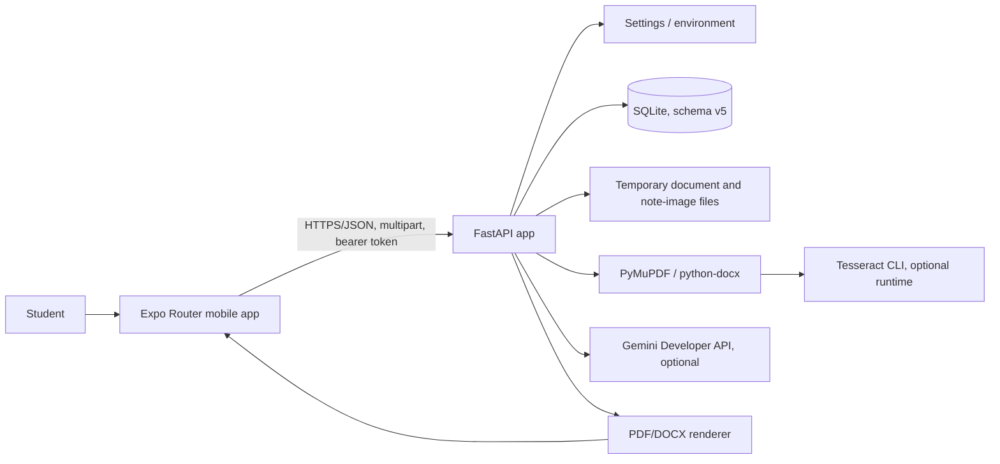

# System overview

## Scope and evidence

This document describes the repository as found during the audit, including the uncommitted source files. It was reconstructed from the application code and compared with `README.md`, `docs/architecture.md`, `docs/api-contract.md`, `docs/data-model.md`, and `docs/implementation-plan.md`. A source file demonstrates implementation, not production availability. Runtime and device behavior are called out only where independently verified.

## System context

The application is an Android-first Expo / React Native client backed by a Python FastAPI service. The mobile client uploads source material, obtains an anonymous per-install bearer identity, displays study results, and downloads legacy study-job exports. The server extracts and stores document material, runs deterministic topic operations, optionally calls Google Gemini, and renders PDF/DOCX exports.

The diagram describes code dependencies, not an independently verified deployed topology. `render.yaml` selects a Docker web service with ephemeral `/tmp` paths. The Dockerfile runs one Uvicorn worker because background study jobs are in-process.

## Architectural layers

| Layer | Main files | Responsibility |
|---|---|---|
| Mobile screens and navigation | `mobile/app/*.tsx`, `_layout.tsx` | Expo Router stack; screen-local state; interaction, validation, status and result rendering. |
| Mobile shared UI | `mobile/components/screen.tsx`, `primary-button.tsx` | Page wrapper, cards and buttons. |
| Mobile API and workflow helpers | `mobile/services/apiClient.ts`, `topicWorkflow.ts`, `mobile/types/api.ts` | Identity bootstrap, fetch/timeout/error mapping, upload/download, endpoint wrappers, DTOs and small topic validation/formatting helpers. |
| HTTP/API | `backend/app/main.py`, `backend/app/api/*.py` | Middleware, routes, request validation, ownership checks, response assembly and API errors. |
| Schemas | `backend/app/schemas/*.py` | Pydantic request/response DTOs and literal/status constraints. |
| Domain/application services | `backend/app/services/*.py` | Parsing, OCR, study processing, AI calls, matching, export, data stores and user identity. |
| Persistence and files | `services/db.py`, `storage.py`, `job_store.py`, `topic_sources.py` | SQLite migrations and serialized operations; document/job/topic metadata; temporary source files and retention. |
| Deployment | `backend/Dockerfile`, `render.yaml`, `mobile/eas.json`, `mobile/app.json` | Container runtime, Render environment, Expo native config and EAS profiles. |

There is no ORM, external job queue, cloud object store, vector database, or account service in the inspected source. `Database` uses stdlib `sqlite3`; the stores serialize access with locks. Test fixtures can use in-memory stores when SQLite is not configured.

## Two independent user workflows

### Document study jobs

`Home -> Upload -> Topics & Mode -> Results`.

The user uploads one PDF/DOCX. The server extracts source sections and creates an owner-scoped document record. The user selects `extracted_text_only`, `text_and_summaries`, or `summaries_only`; the server processes units synchronously for small documents and schedules a process-local `asyncio` task for larger documents. The result becomes a persisted study job, appears in Home history, can be reopened by job ID, and can be exported as PDF or DOCX. See `mobile/app/results.tsx`, `backend/app/api/study.py:create_study_job`, `services/study_processor.py:process_document`, and `services/job_store.py:JobStore`.

### Jottings/photo topic flow

`Home -> Photo Notes -> Photo Topics -> Photo Results` (or `Upload?flow=photo -> Photo Notes`). The user links a PDF/DOCX, enters typed jottings and/or uploads note photos, edits OCR transcripts, reviews generated or manually edited topics, reviews deterministic matches, and requests passages and/or AI output. Topic source inputs are persisted with TTL; the generated study output is returned directly and is not saved as a study job. There is no topic-output history or export endpoint. See `mobile/app/photo-notes.tsx`, `photo-topics.tsx`, `photo-results.tsx`, and `backend/app/api/topic_sources.py`.

## Runtime lifecycle and request flow

1. Expo Router starts at `mobile/app/index.tsx`; the Home effects request `/health` and owner-scoped job history.
2. The first authenticated API call gets a token from `expo-secure-store` or registers at `POST /api/v1/users`. The client holds it in memory and secure storage. `apiClient.ts:send` attaches `Authorization: Bearer ...`; the optional app gate is separately sent as `X-App-Token` if configured.
3. FastAPI imports routers and installs access-token, CORS, exception, and request-ID middleware in `backend/app/main.py`. Lifespan configures SQLite/stores, hydrates persisted records, reconciles document files, sweeps expiry, and starts periodic cleanup.
4. A route validates the owner-scoped record and delegates CPU/file work through `run_in_threadpool` where implemented. The study endpoint creates a background task for large documents; other study/topic outputs are direct request responses.
5. Stores write metadata and JSON payloads to SQLite and uploaded bytes below configured temporary directories. Gemini is called over HTTP only for AI modes. Export is rendered in-process from a persisted study-job payload.
6. Mobile maps non-2xx/network/timeouts to `ApiError`; screens show a user-safe message and, in some cases, retry or fallback actions.

Middleware identity behavior: `_requires_user_identity` covers `/api/v1/*` except the user-registration path. `/health` and registration are not behind the optional app gate. A valid user bearer is required for data API routes even when `APP_ACCESS_TOKEN` is absent. If the app gate is configured, a provided app token must also match; a user bearer alone can satisfy the gate when no app-token header/query is sent.

## State and ownership boundaries

- Document source bytes, parsed sections, warnings and extraction metadata are owner-scoped by `owner_id` on `documents`.
- Study-job payloads and history are owner-scoped in `study_jobs`.
- Topic source metadata, typed jottings, topics and transcripts are owner-scoped in `topic_sources` and `topic_source_images`; note image bytes are separate files.
- The mobile client persists only the opaque identity token in SecureStore. Active UI state is screen-local and route parameters carry document/job/source IDs. No local study history database is present in the inspected tree.
- A deleted source document can leave completed study-job output readable/exportable. A topic source can refer to a missing document, but its matching pipeline reports the missing source and cannot ground output against it.

## External integrations and constraints

- **Gemini Developer API:** optional HTTP integration; configured by backend environment. Key is not part of mobile code. AI output depends on provider availability and quotas.
- **Tesseract:** local CLI, optional at runtime; Docker installs English data. Handwriting is explicitly described as unreliable.
- **Expo native APIs:** document picker, image picker/camera, SecureStore, file download/share and router.
- **SQLite + temporary filesystem:** single-instance local persistence. `render.yaml` explicitly configures `/tmp`; Render free storage is ephemeral, so durability across restart is not provided.
- **Android networking:** preview profile embeds the Render URL and `EXPO_PUBLIC_USE_RN_FETCH=true`; production profile does not carry these values in the checked-in `eas.json`.

## Documentation comparison

The architecture/API docs broadly describe the original study and topic APIs, but their status statements are not a source of runtime evidence. After the persistence update, `docs/implementation-plan.md` reports 210 backend tests and mobile integration; the backend suite collected 210 passing tests and mobile typecheck/lint/19 tests passed during this change. Topic study outputs are now persisted (`topic_study_results`, schema v6), appear in Home history, and export to PDF/DOCX. README claims persistence survives restarts, which is true only when deployment storage is durable; current `render.yaml` still uses ephemeral `/tmp`, so deployed results remain non-durable across instances.

## Verification boundary

The previous audit in this conversation ran 200 backend tests and 19 mobile tests successfully; TypeScript and lint checks passed. Android export failed because Windows denied execution of `hermesc.exe`. No live backend, live Gemini, EAS build, or physical Android run was verified. Passing tests establish tested code paths, not deployment readiness or end-to-end UX behavior.
